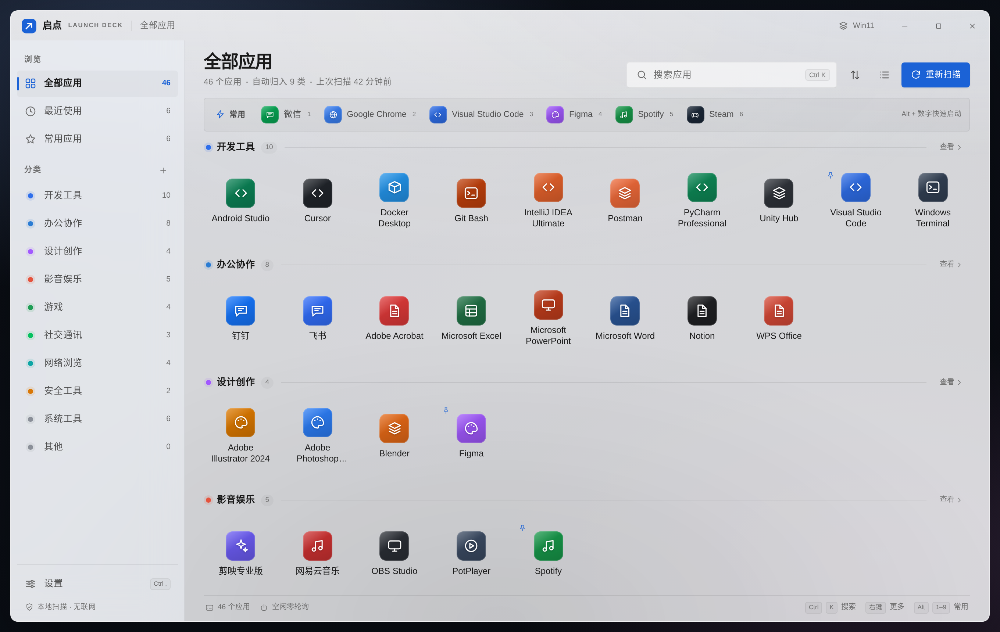
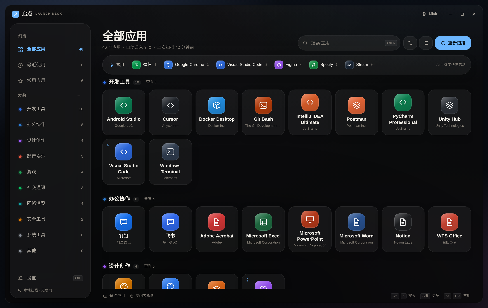

# 启点 QiDian

> 一个安静、轻量的 Windows 应用分类启动台 + 系统优化工具箱。
> 作者：**望满天星辰** · 原创项目

**当前版本 v1.3.1** · [下载安装包](https://github.com/wang-stares/qidian/releases/latest) · [更新日志](CHANGELOG.md)

**启点（QiDian）** 是一款面向 Windows 10 / 11 的本地工具：它自动扫描本机的全部应用并按分类整理成启动台，同时内置一套插件化的「体检 / 优化 / 内存 / 后台 / 应用管理 / 启动与托盘」工具箱，让小白也能一键完成系统优化。所有操作都在本机完成，不联网、无广告、不常驻后台。

<p align="center">
  
</p>

## 功能一览

### 🚀 应用启动台

- 自动扫描开始菜单、桌面、任务栏快捷方式、卸载注册表、App Paths 与 Microsoft Store 应用
- 按分类整理（开发工具 / 办公协作 / 设计创作 / 影音娱乐 / 游戏 / 社交通讯 / 网络浏览 / 安全工具 / 系统工具 / 其他），分类可自定义
- 三种排序方式：**名称 / 最近使用 / 常用优先**（每次启动自动累加计数）
- 智能搜索：名称 / 去空格紧凑名 / 词首缩写 / 拼音全拼与首字母 / 中英混排拼音 / 发布者及其首字母 / 分类 / 安装路径多路加权，`xiaomi`、`xm`、`vscode`、`weixin`、`miconnect`、`qqyinyue`、`tx` 都能直接命中；零结果时自动启用 fzf 式模糊兜底，`chorme`、`weixn` 也能找回目标；评分相同的应用按常用度与最近使用裁决
- 网格 / 列表两种视图，常用应用（固定）快捷栏、最近使用视图
- 外观高度可自定义：5 套界面风格（Win11 / Miuix / macOS / Mono / 自定义）、12 套主题配色、6 款壁纸与本地壁纸库（多图上传、铺放方式、位置、缩放、不透明度 / 模糊 / 明暗可调）、8 种强调色或任意自取色、圆角与模糊档位；支持把整套外观保存为「我的主题」
- 高性能：图标磁盘缓存 + 内存 LRU（上限 600）+ 6 线程并行提取 + 网格分帧渲染，万级目录秒开

### 🩺 系统体检

- 系统健康评分：内存 / CPU / 磁盘 / 启动项综合打分，每项扣分明细可见
- CPU 与多磁盘状态、物理磁盘健康（SMART 摘要）、资源占用排行、评分趋势
- 一键**复制体检报告**：把系统版本、硬件状态、扣分项整理成纯文本，方便求助

### ⚡ 系统优化

- 可撤销的一键优化：51 项注册表策略（参考 Winhance / WinUtil / Optimizer），写入前自动备份原值、写入后回读校验，可按隐私 / 性能 / 服务 / 更新分类筛选，单项或全部还原
- 27 处垃圾清理：系统临时文件、更新缓存、浏览器与聊天软件缓存、转储、回收站、Windows.old
- 电源计划切换（含隐藏的**卓越性能**方案自动创建）
- **网络优化**：阿里 / 腾讯 / Google / Cloudflare 公共 DNS 一键切换（自动备份、可还原）+ 网络连通性诊断 + 刷新 DNS 缓存
- 深层内存清理（管理员级系统缓存 / 待机列表）

### 🧠 内存管理

- 自动识别物理内存与提交内存，按压力动态调节启点自身 WebView2 档位
- 工作集释放、管理员级系统缓存清理、空闲自动释放、隐藏挂起
- 全屏 / 电池供电自动降级，保证不干扰工作

### 🛡️ 后台管理

- 全量自启动扫描：注册表 Run/RunOnce、启动文件夹、计划任务、自动服务
- 启动项**影响评估**（高/中/低）与建议（保留 / 关闭 / 可选），一键关闭建议项
- 运行中进程按应用分组，说明每个进程的用途，关键进程保护

### 🗑️ 应用管理

- 已安装应用列表（搜索 + 按占用排序），调用应用自带卸载程序
- **完全清除**：卸载后可选择连安装文件夹一并删除，删除前再次核对引用
- 扫描安装目录与应用数据目录，标注疑似残留，确认后删除（可选回收站）

### 🔑 启动与托盘

- 托盘快捷启动常用应用、自定义全局快捷键（显示/隐藏、为应用设置启动快捷键）
- 开机自启动、关闭行为可选（最小化到托盘 / 退出）

## 最近更新

- **v1.3.1**（2026-10-28）macOS 主题补齐原生材质：标题栏 / 侧栏 / 快速启动栏 / 详情面板 / 右键菜单 / Toast / 设置弹窗全部改为毛玻璃（24–42px 背景模糊 + 160–180% 饱和度），弹窗遮罩加入背景模糊；交通灯内描边、搜索框内嵌高光、柔和焦点环与覆盖式细滚动条；低功耗模式自动关闭这些模糊。
- **v1.3.0**（2026-10-28）主题视觉重构：macOS 风格改为真正的 macOS 布局语言（左上角交通灯、居中标题、Finder 式实心选中侧栏、推按钮与内嵌搜索框）；极简 Mono 建立单色编辑风格（等宽大写标签、细边框方形磁贴、左侧竖条选中、黑 / 白反色主按钮、方角描边控件）。
- **v1.2.0**（2026-10-28）主题与壁纸高度自定义：新增「自定义」界面风格（浅色 / 深色分别设置背景、面板、文字色，圆角 / 面板透明度 / 模糊 / 图标大小四档滑杆）；新增本地壁纸库（一次多选上传、缩略图切换、最多 12 张，图片保存在数据目录）、图片壁纸铺放方式 / 位置 / 缩放调节，并为照片壁纸自动叠加内容遮罩保证可读；「我的主题」同步记录调色板与壁纸调用参数。
- **v1.1.0**（2026-10-28）主题系统全面扩充：界面风格增至 4 套（新增 macOS、极简 Mono），配色增至 12 套（星云 / 薄荷 / 石墨 / 咖啡 / 极光 / 蜜桃），新增壁纸系统（6 款内置 + 本地图片，支持不透明度 / 模糊 / 明暗调节）、8 种强调色与任意自取色、圆角与面板模糊档位，并支持把整套外观保存为「我的主题」一键还原。
- **v1.0.5**（2026-10-28）搜索继续升级：新增中英混排拼音索引（`QQ音乐` → `qqyinyue`、`微信 WeChat` → `weixinwechat`、`WPS Office 文档` → `wpsofficewendang`）与发布者首字母（`tx` → 腾讯系、`jinshan` → 金山办公）；同分结果按常用度与最近使用裁决，强相关结果不会被热门应用跨档顶掉；2 个字符的拉丁词不再对发布者拼音做子串匹配，`in`、`not`、`files`、`program` 保持零结果。
- **v1.0.4**（2026-10-28）搜索增加模糊兜底：参考 fzf 的子序列打分（词首 / 连续 / 间隔惩罚）与编辑距离，常规搜索零结果时再启用，拼写略错（`chorme`、`weixn`）也能找回应用，短词不产生噪声。
- **v1.0.3**（2026-10-27）应用搜索全面升级：新增多字段加权索引（名称 / 紧凑名 / 缩写 / 拼音 / 发布者 / 分类 / 路径），AND 多关键词 + 相关性排序；短拉丁词不再裸子串匹配、路径索引剔除通用目录名，既补回漏找的应用，也压掉误命中。
- **v1.0.2**（2026-10-27）修复「应用扫描后消失」：从安装目录与卸载器所在目录递归反推主程序，快捷方式指向卸载器时同样反推；主程序挑选改为评分制，旧缓存自动失效重扫。
- **v1.0.1**（2026-10-27）修复扫描把卸载程序当成应用的问题：识别 unins* / uninstall* / uninst / auxunin / 卸载* 等卸载器命名，快捷方式、注册表 DisplayIcon 与 App Paths 三处统一过滤。
- **v1.0.0**（2026-10-27）正式开源：全部核心功能首次公开，MIT License。

## 界面预览

| 亮色主题 | 暗色主题 |
| --- | --- |
|  |  |

## 宣传片

56 秒功能介绍（README 内为 GIF 预览，可直接播放；完整 1080p 版见下方链接）：


[▶ 下载完整版 1080p 宣传片（MP4，11 MB）](https://github.com/wang-stares/qidian/releases/download/v1.0.0/qidian-promo-1080p.mp4)

## 系统要求

- Windows 10 1809（Build 17763）或更高版本；Windows 11 已内置 WebView2
- Windows 10 需要安装 [Microsoft Edge WebView2 Runtime](https://developer.microsoft.com/microsoft-edge/webview2/)
- x64 架构
- 部分系统级功能（深层内存清理、公共 DNS 切换、系统级临时文件清理）需要管理员权限，安装程序默认以管理员安装

## 安装

直接下载 [Releases](https://github.com/wang-stares/qidian/releases) 中的安装包：

- `QiDian-Setup-x.y.z-x64.exe` —— NSIS 安装包，建议使用
- `QiDian-x.y.z-win64.zip` —— 绿色免安装版（含安装包与 SHA256 校验）

## 从源码构建

```bash
# 1. 安装前端依赖
npm install

# 2. 构建前端
npm run build

# 3. 交叉编译 Windows 后端（Linux/macOS 上使用 cargo-xwin；Windows 直接 cargo build）
cargo install cargo-xwin
cd src-tauri
cargo xwin build --release --features custom-protocol --target x86_64-pc-windows-msvc

# 4. 打包 NSIS 安装程序（需要 makensis）
cd installer && makensis QiDian.nsi
```

> 浏览器预览（不依赖 Windows）：`npm run preview`，前端会使用演示数据。

## 技术栈

| 层 | 技术 |
| --- | --- |
| 桌面框架 | [Tauri 2](https://tauri.app) + Rust 2021（`windows` / `winreg` / `windows-core`） |
| 前端 | TypeScript + Vite，手写渲染（无框架），单文件 `main.ts` + rAF 合并渲染 |
| 界面 | 原生 CSS（tokens + components），5 套界面风格（含自定义调色板）× 12 套配色 × 壁纸层（支持本地壁纸库），强调色支持自取色 |
| 打包 | NSIS（管理员权限、WebView2 检测、卸载器） |
| 图标 | 自研 PIL 生成脚本（`scripts/gen-icons.py`，4× 超采样 + 小尺寸分级） |

## 目录结构

```
qidian/
├── src/                  # 前端源码（main.ts / api.ts / mock.ts / types.ts / style）
├── src-tauri/
│   ├── src/              # Rust 后端（lib.rs + 各功能模块 .rs）
│   ├── resources/        # 插件清单（manifest.json）
│   ├── icons/            # 应用图标
│   └── Cargo.toml
├── installer/            # NSIS 安装脚本
├── scripts/              # 版本管理 / 图标生成 / 更新公告脚本
├── preview/              # 界面截图
└── CHANGELOG.md          # 更新日志
```

## 设计原则

- **只读优先**：体检只读不改；优化类动作写入前备份、写入后回读校验，全部可还原
- **插件化职责拆分**：体检 / 优化 / 内存 / 后台 / 应用管理 / 启动托盘各自独立，互不掺和
- **本地优先**：全部操作在本机完成，不联网、不上传任何数据、不常驻后台
- **性能优先**：TTL 缓存、并行提取、分帧渲染、LRU 上限，启动与滚动都保持流畅

## 原创声明

本项目为 **望满天星辰** 的原创作品，从 0 到 1.0.2 逐版本独立设计与实现，未复制任何现有应用的界面与代码；部分优化项的注册表策略参考了 Winhance / WinUtil / Optimizer 等开源项目的公开资料。

## 更新日志

完整的版本历史见 [CHANGELOG.md](CHANGELOG.md)。

## 许可证

[MIT](LICENSE) © 2026 望满天星辰
